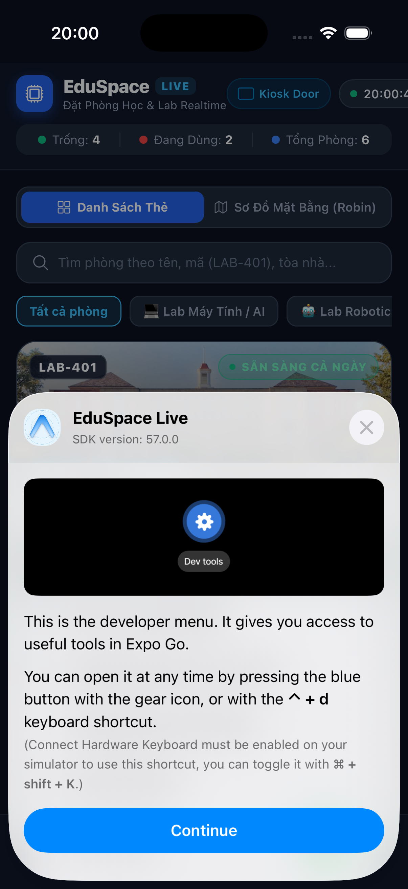

# EduSpace Live - Đặt Phòng Học/Lab Realtime (React Native iOS)

<div align="center">


**Ứng dụng di động đặt phòng học & phòng Lab thời gian thực chất lượng cao dành cho iOS.**

[Xem Báo Cáo Chi Tiết](./BAO_CAO_DU_AN.md) • [Tính Năng](#tính-năng-nổi-bật) • [Cài Đặt & Chạy](#cài-đặt--khởi-chạy)

<br/>



</div>

---

## 🌟 Tính Năng Nổi Bật

- **🟢 Trạng thái Realtime (Robin Style)**:
  - Màu nhận diện trực quan: Xanh lục (Trống), Đỏ (Đang dùng kèm thời gian còn lại), Vàng (Sắp hết giờ).
  - Nút **"Đặt nhanh 30 phút" (Quick-Book)** 1 chạm tại chỗ.
- **🗺️ Sơ đồ tầng tương tác (Robin Floor Map)**:
  - Bản đồ kiến trúc các tầng (Tầng 1 -> 4).
  - Từng phòng đổi màu sống động theo trạng thái thực tế.
- **📅 Ma trận lưới giờ (LibCal Grid)**:
  - Chọn 7 ngày trong tuần, các khung giờ 08:00 - 20:00.
  - Tự động phát hiện và ngăn chặn trùng lịch (Conflict Detection).
- **🎫 Vé Apple Wallet Pass & QR Check-in**:
  - Thẻ vé bo góc cong, rãnh xé vé và mã QR.
  - Quét QR check-in, gia hạn thêm 30 phút, hoặc trả phòng sớm (Release room).
- **📱 Chế độ Kiosk màn hình cửa phòng (Robin Door Display)**:
  - Màn hình toàn màn hình cho iPad gắn ngoài cửa phòng học, đổi màu Xanh/Đỏ lớn và đặt nhanh tại chỗ.
- **⚡ Live Activity / Dynamic Island**:
  - Banner nổi đếm ngược phiên học/nghiên cứu hiện tại.

---

## 🚀 Cài Đặt & Khởi Chạy

```bash
# 1. Cài đặt dependencies
npm install

# 2. Khởi chạy trên iOS Simulator
npx expo start --ios

# 3. Khởi chạy bản Web
npx expo start --web
```

---

## 📄 Báo Cáo Đầy Đủ

Vui lòng tham khảo tệp [BAO_CAO_DU_AN.md](./BAO_CAO_DU_AN.md) để xem chi tiết kiến trúc kỹ thuật, thuật toán và phân tích luồng hệ thống.
